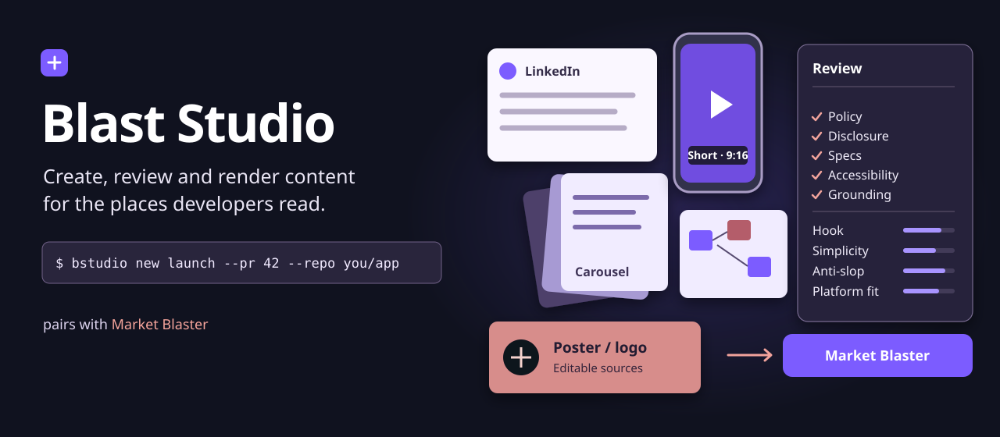
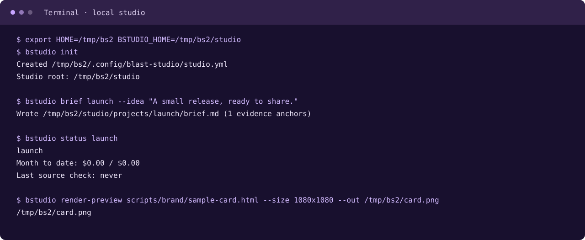
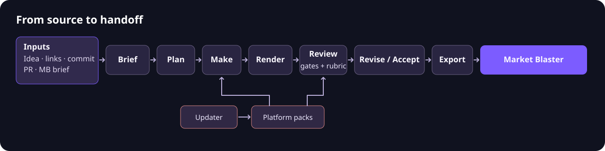

<p align="center">
  
</p>

<p align="center">
  <a href="https://github.com/edwinjosechittilappilly/blast-studio/actions/workflows/ci.yml"></a>
  <a href="https://edwinjosechittilappilly.github.io/blast-studio/"></a>
  <a href="LICENSE"></a>
  
  
  <a href="https://github.com/edwinjosechittilappilly/market-blaster"></a>
</p>

# Blast Studio

Blast Studio turns an idea, notes, links, a commit, a PR or a Market Blaster brief into platform-specific content. It keeps the evidence, editable sources, renders and reviews together in a private studio. Export packages the reviewed campaign as one zip for [Market Blaster](https://github.com/edwinjosechittilappilly/market-blaster); publishing remains a separate step.

## Quickstart

Requires Node 22.18 or newer, access to this private repository and a configured agent. Rendering and particular inputs may require additional tools; `doctor` reports their availability.

```bash
gh repo clone edwinjosechittilappilly/blast-studio
cd blast-studio
npm install
npm link
bstudio init
bstudio install-skills
bstudio doctor
```

Edit `~/.config/blast-studio/studio.yml` for your brand, platforms and agent commands. The default studio root is `~/BlastStudio`, outside the repository. Paid generation is disabled until you set a budget.

```bash
bstudio brief launch --idea "Explain the feature and who it helps"
# Add evidence and caveats to ~/BlastStudio/projects/launch/brief.md
bstudio plan launch
bstudio make launch
bstudio render launch
bstudio review launch
bstudio revise launch                      # if revisions are needed
bstudio export launch --mb /path/to/market-blaster-project
```

The agent commands must be installed and configured before planning, making or reviewing. Inspect the content and review before exporting. See [getting started](docs/getting-started.md) for requirements and alternatives.

<p align="center"></p>
<p align="center"><sub>Output from a real run on <a href="https://github.com/edwinjosechittilappilly/market-blaster/commit/adbc177d3877f45c98912c17b5ba3ccf33287ccb">market-blaster@adbc177</a>, lines trimmed. Reddit stayed a human task: its outline needs the subreddit rules checked by a person.</sub></p>

## How it works



## What it makes

| Format | Source and output |
|---|---|
| Text and threads | Platform-specific posts and thread handoffs |
| Cards, posters and carousels | Editable HTML, rendered images and carousel PDF |
| Logos and diagrams | SVG logos; Mermaid or D2 diagram sources and rendered outputs |
| Short video and terminal demos | Aspect-specific HyperFrames compositions or VHS tapes; captions and video outputs |
| Illustrations and voiceover | Optional provider-generated assets subject to configuration, consent and budget |

Renderer and provider requirements vary. See [formats](docs/formats.md).

## How review works

| Step | Purpose |
|---|---|
| Gates | Check destination policy, disclosure, evidence, accessibility, format and rights before export. |
| Rubric | Rate applicable editorial criteria from 0 to 2, with evidence and a suggested fix; N/A does not count. |
| Revise | Apply findings, render again and re-review. |
| Accept | Record a human reason to override scores; a failed gate cannot be overridden. |

Scores are editorial judgments, not predictions of reach. See [review](docs/review.md).

## Where it goes

| Studio platform | Market Blaster destination / handoff |
|---|---|
| DEV, Hashnode, LinkedIn, X, Bluesky, Mastodon, Threads | Corresponding destination; media support and handoffs vary. |
| GitHub Discussion, Gist | Corresponding destination. |
| Hacker News | Excluded from generated plans; a human-authored candidate is required. |
| Reddit, Product Hunt, Lemmy, newsletter | Corresponding destination; outline or manual workflow. |
| Medium, Substack | Corresponding manual handoff. |
| YouTube Shorts, Instagram, TikTok, daily.dev | Manual export; record the published URL with `bstudio mark`. |

Platform rules change. Check the [platform packs and guides](docs/platforms.md) and the destination's current policies before posting.

## How it compares

The [research survey](docs/research/existing-skills.md) describes different tools for parts of this workflow. A dash means not documented in that survey; it does not assert that a product lacks a feature. ✅ supported · ◐ partial or different scope · — not documented.

| | Blast Studio | [Typefully](https://typefully.com/) | [Marketing Skills](https://github.com/coreyhaines31/marketingskills) | [HyperFrames](https://github.com/heygen-com/hyperframes) |
|---|:-:|:-:|:-:|:-:|
| Evidence from ideas and code changes | ✅ | — | — | — |
| Platform-specific writing | ✅ | ✅ | ◐ workflows | — |
| HTML video rendering | ✅ via HyperFrames | — | — | ✅ |
| Platform policy and editorial review | ✅ | — | — | — |
| Publishing and scheduling | ◐ export to Market Blaster | ✅ | — | — |

## Safety and honesty

- Review checks are aids, not proof of factual accuracy, policy compliance or future reach. Check claims and current destination rules yourself.
- Disclosure requirements still apply to AI-generated text and media. Anti-slop review improves clarity; it is not an authorship detector.
- Blast Studio does not automate websites or publish posts. Market Blaster handles its own API and manual handoffs.
- The agent runs as your user. Its workspace and filtered environment are not an operating-system security sandbox.
- Paid generation defaults to a zero cap; external reference uploads require explicit consent.
- Local storage does not make model calls private: configured agents may send brief and project content to their model providers. Export archives include the full brief and evidence; inspect them before sharing.

## Documentation

Start with [getting started](docs/getting-started.md), then read the [workflow](docs/workflow.md), [formats](docs/formats.md), [review](docs/review.md), [platforms](docs/platforms.md), [budget](docs/budget.md), [configuration](docs/configuration.md) and [command reference](docs/commands.md). The [updater](docs/updater.md), [dashboard](docs/dashboard.md) and [architecture](docs/architecture.md) pages cover operations and design. The full site is at [Blast Studio docs](https://edwinjosechittilappilly.github.io/blast-studio/).

## Development

```bash
npm install
npm test
npm run typecheck
make docs-serve
```

The Market Blaster import integration test uses a checkout at `../market-blaster` by default. Set `MARKET_BLASTER_DIR` to use another checkout, and run `npm ci` there first. The test skips when the checkout is absent. CI runs it when the `MB_CHECKOUT_TOKEN` repository secret provides access to the Market Blaster repository.

## License

[Apache-2.0](LICENSE).
