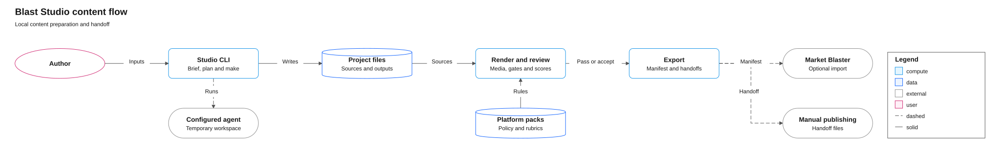

# Architecture

Blast Studio is a local CLI for preparing platform-specific content, reviewing it and exporting a handoff. It does not publish posts. Market Blaster is a separate application that can import a Studio manifest; some destinations and formats require a manual handoff.

The diagram shows the content path. Platform packs, the budget ledger and the local dashboard support that path without being separate hosted services.

## Content flow

1. `brief` assembles source material into a project brief. `plan` uses the brief and platform packs to describe posts and assets. `make` produces post and asset sources through the configured agent.
2. The agent works in a temporary workspace with an allowlisted environment and, by default, an OS sandbox (`sandbox-exec` on macOS, `bwrap` on Linux) that hides the studio root. Only allowed output paths are copied back; a `render-preview` shim is available there. Limits are listed under [agent isolation](configuration.md#agent-isolation).
3. `render` turns sources into media and records output metadata. Playwright renders HTML stills and carousels with `file:` access limited to the asset, bundled templates and fonts, and other assets' outputs; resvg rasterizes SVG logos; Mermaid and D2 produce diagrams. HyperFrames renders video compositions and VHS handles terminal demos. Image and voice providers are optional; with a provider set to `none`, render skips those assets and says so.
4. `review` runs deterministic checks and, when configured, a reviewer command. It writes a JSON review per platform and a human-readable summary. `revise` uses the findings to change content and repeat rendering and review.
5. `export` requires a passing or accepted review, passing recorded gates, and matching post and media hashes. By default it writes one campaign zip (`<slug>.campaign.zip`, [package contract](design/campaign-package.md)) that `mblast import` reads; `--dir` writes the v1 directory. Destinations without a Market Blaster mapping, threads and LinkedIn PDF carousels also receive manual handoffs.

## Storage and boundaries

Projects are directories under the configured Studio root. They contain `brief.md`, `plan.yml`, posts, asset sources and outputs, reviews, and exports. Platform packs in this repository supply policy, limits, rubric and source references. The source updater checks registered sources and can propose pack changes for review.

Paid provider calls use the budget ledger for reservations and settlement; agent runs are recorded separately. The dashboard is a local Node HTTP server for viewing project and operational data and editing supported settings. It is not a publishing service.

The review hash covers title, trimmed body, and media basenames and alt text in order. It does not hash media file contents (Market Blaster's own approval hash does). Review checks and export behavior are implemented in [`src/commands/review.ts`](https://github.com/edwinjosechittilappilly/blast-studio/blob/main/src/commands/review.ts), [`src/review/gates.ts`](https://github.com/edwinjosechittilappilly/blast-studio/blob/main/src/review/gates.ts) and [`src/export.ts`](https://github.com/edwinjosechittilappilly/blast-studio/blob/main/src/export.ts).

## Decisions

- [HyperFrames for video](adr/0001-hyperframes.md)
- [HTML templates for text in graphics](adr/0002-html-templates-for-text.md)
- [Reviewer gates before scores](adr/0003-reviewer-gates-before-scores.md)
