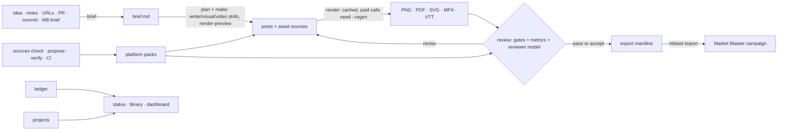

# Blast Studio design

Status: revised after [design review 1](../reviews/design-review-1.md) (all 5 blockers addressed) · Bead:
blast-studio-v3l.6 · Research: [existing skills](../research/existing-skills.md),
[platform virality](../research/platform-virality.md), [media stack](../research/media-stack.md) · Delivery:
[Market Blaster](https://github.com/edwinjosechittilappilly/market-blaster)

## Context

Market Blaster publishes safely, but it only drafts text from a git range. Blast Studio creates platform-native content
from any starting point: an idea, links, a commit, a PR or a Market Blaster brief. It covers every format the owner
named (text, images, carousels, diagrams, posters, logos, short video and motion graphics) and scores each piece with
platform-specific reviewers before handing a versioned package to Market Blaster.

The research established these points, which shape the design:

1. **Ranking differs by platform, viewer and experiment.** No primary source proves a universal hook length, hashtag
   count, link penalty or cadence. Reviewers judge clarity, audience fit, evidence and format, and never predict reach.
2. **Policy gates come before scores, and they cover text as well as media.**
   - **No generated text allowed:** HN bans generated text and automated posting; daily.dev rejects AI-generated
     content; Buttondown bans primarily machine-generated prose and images.
   - **Disclosure required:** DEV has three AI-disclosure tiers; Medium requires AI-text disclosure and captions on
     generated images; Threads has `is_made_with_ai`.
   - **Disclosure recommended only:** LinkedIn.
   - **Scope unverified:** Meta's self-disclosure.
3. **Text inside graphics comes from layout code, not image models.** HTML/CSS templates rendered with Playwright give
   exact type and an editable source.
4. **HyperFrames** (Apache-2.0, HTML to MP4, official skills, Node 22 and FFmpeg) shares the still templates' HTML.
   Each aspect ratio is its own composition, because a crop is not a re-layout. **VHS** covers terminal demos.
5. **Platforms change often.** A sources registry with path-level detectors and stored snapshots makes reviewable
   updates possible.

## Goals

1. After `bstudio project new <project>`, `bstudio new <project>/<campaign>` turns any combination of inputs (`--idea`, `--note`, `--url`, `--pr`, `--commit`, `--repo`,
   `--mb-brief`) into reviewed content.
2. **Formats, each with an editable source and rendered outputs:**
   - text;
   - X/Bluesky/Threads threads, exported as handoff files;
   - images, posters, quote and code cards;
   - logos;
   - carousels (PNG slides; a LinkedIn PDF sent as a manual handoff);
   - diagrams;
   - short videos at 9:16, 1:1 and 16:9 with captions;
   - motion graphics and terminal demos;
   - optional AI illustrations and AI voiceover.
3. **Each post has a platform reviewer:**
   - deterministic gates (policy, disclosure, specs, accessibility, fabricated metrics);
   - 0–2 rubric scores with `N/A`, evidence and a fix;
   - a revise loop;
   - an explicit human `accept` that can override scores but never gates.
4. **Anti-slop and simplicity:** deterministic lexicon, structure and readability checks, plus a reviewer that follows
   the humanizer skill. This is aimed at clarity, never at hiding machine authorship. Disclosure rules always apply.
5. **Export to Market Blaster:** a versioned manifest consumed by a new `mblast import`. Market Blaster also gains media
   attachments through its own OpenSpec change.
6. **Updater:**
   - `sources check` stores snapshots;
   - `sources propose` drafts pack edits with your local agent;
   - weekly CI reports changes, and opens a pack-data-only PR when a key is configured;
   - `sources verify` records human confirmation.
7. **Budget:** a monthly cap you can change at any time (`bstudio budget set`, or the dashboard), plus a per-project
   cap and a provider-upload policy. The reserve/settle ledger also counts agent runs.
8. **Library and dashboard:** `bstudio status` and `bstudio library` in the terminal, and `bstudio dashboard`, a local
   web UI for projects, posts, scores, media, spend, providers and the updater.

**Non-goals:**
- publishing (Market Blaster does it);
- engagement analytics;
- stock-media marketplaces;
- voice cloning;
- automating any website;
- Remotion and Motion Canvas adapters in this iteration (see Alternatives).

## Milestones (all in scope for this build, in this order)

| Milestone | Delivers |
|---|---|
| M1: text and stills | Inputs to brief to plan; the writer; HTML cards, posters, quote and code cards, carousels (PNG and PDF), SVG logos; Mermaid and D2 diagrams; gates and reviewer; `accept`; `mark`; export manifest; `mblast import` in Market Blaster; `sources check` |
| M2: motion and media | HyperFrames compositions per aspect ratio; VHS demos; captions (VTT and burned in); image providers (`gemini`, `openai`, `omp`, `none`) under the budget; voice provider (`openai`, `none`); Market Blaster media attachments |
| M3: operations | `sources propose`, `sources verify` and the platform-watch CI; `budget`, `library`, `status`, `dashboard`; review calibration |

## Concepts and files

The **studio root** is outside any git repo by default: `~/BlastStudio`, overridable with `studio.root` in
`~/.config/blast-studio/studio.yml` or `BSTUDIO_HOME`. Unreleased content never lands in a public repo by accident. The
code repo holds code, skills, templates and platform packs only.

| Term | Meaning |
|---|---|
| Project | `<root>/projects/<project>/`: shared metadata and evidence for one or more campaigns |
| Campaign | `<root>/projects/<project>/campaigns/<campaign>/`: one idea or change |
| Brief | `brief.md`. Sections use `## [E<n>] <title>` (the Market Blaster format) and may carry `status: shipped|planned|claim` so writers and reviewers keep shipped and planned apart |
| Platform pack | `platforms/<id>/pack.yml` (data) and `platforms/<id>/guide.md` (writing guidance). Each value is `{value, source, verified}` or `unknown` |
| Plan | `plan.yml`: per platform, the post type, 3 hook options, the angle and the assets needed |
| Post | `posts/<platform>.md`: text plus frontmatter (`media`, `evidence`, `disclosure`, `thread` items) |
| Asset | `assets/<id>/`: `source.*`, `out/*`, `asset.yml` |
| `asset.yml` | Kind; provider; prompt hash; cost; dimensions and duration; license; `aiGenerated`; `embeds` (composites inherit `aiGenerated` from everything they embed); trademark-search checkbox for logos |
| Review | `reviews/<platform>.json` (schema in `schemas/review.schema.json`) |
| Ledger | `<root>/ledger.jsonl`: one `reserved` line, then one `settled` line per paid call or agent run |
| Library | Derived on request by scanning `projects/*/`. No stored index |

## Platform to Market Blaster mapping

| Studio platform | Market Blaster destination | Text | Media path |
|---|---|---|---|
| devto | devto (canonical home) | API | Cover image needs a hosted URL (`devto.coverUrl` or handoff); inline images as hosted URLs or handoff |
| linkedin | linkedin | API when `api: true`, else handoff | API: images through Crosspost `images`. PDF carousel: always handoff |
| x | x | Intent link (owner decision) | Manual attach. Threads go out as a handoff file |
| bluesky | bluesky | API | Images (up to 4, 2 MB each) **replace** the link card; video with VTT captions; gallery later |
| mastodon | mastodon | API | Media upload with description; async video (poll); limits from `/api/v2/instance` |
| threads | threads | Handoff | Manual |
| hn | hn | Original URL and title only | None |
| reddit, producthunt, lemmy, newsletter | same ids | Outline only | Manual |
| github-discussion | github-discussion | API | Images as hosted URLs, or none |
| gist | gist | API | SVG and text files only |
| medium, substack | same ids | Handoff | Manual, with the AI-disclosure line |
| youtube-shorts, instagram, tiktok, dailydev | none | n/a | `exports/<platform>/` for manual upload. `bstudio mark` records the permalink |

## Architecture

## Commands (`bstudio`)

| Command | Behaviour |
|---|---|
| `init` | Writes the global `studio.yml`: brand kit (OFL fonts only in this repo; user fonts stay local), voice rules, platforms, agent and reviewer commands, providers, `budget.monthlyUsd: 0`, `budget.perProjectUsd`, `providers.allowUpload: false` |
| `doctor` | Checks pinned Node, FFmpeg, Playwright Chromium, HyperFrames, VHS, Mermaid and D2 versions; provider keys; `omp` `generate_image.enabled`; the cap; Market Blaster on `PATH` |
| `install-skills` | Links `skills/*` into `~/.agents/skills` and `~/.claude/skills`, and installs the pinned HyperFrames skills |
| `new <project>/<campaign> <inputs>` | `brief`, `plan`, `make`, `render`, `review`; stops at the first failure and prints the command to resume |
| `brief <project>/<campaign> <inputs>` | One anchored section per source. URLs are fetched and reduced to text, fenced as untrusted. `--pr`/`--commit` go through `gh` and git |
| `plan <project>/<campaign>` / `make <project>/<campaign>` | The agent runs in an isolated workspace: no credentials, `bstudio render-preview` available offline and free. Only declared files copy back |
| `render <project>/<campaign> [--regen]` | Deterministic renders. Paid generations are cached by prompt hash and rerun only with `--regen` |
| `review <project>/<campaign>` / `review --calibrate` | Gates, render metrics and reviewer scores. `--calibrate` reports per-criterion agreement with about 20 owner-labelled fixtures |
| `revise <project>/<campaign>` | Applies the findings, re-renders and re-reviews, up to `review.maxRounds` (default 2) |
| `accept <project>/<campaign> <platform> --reason` | Records a human override of scores (never of gates) |
| `export <project>/<campaign> [--mb <path>]` | Writes the campaign package, then runs `mblast import` and `mblast check` when configured. Refuses posts without `pass` or `accepted`. Includes `studio.reviewHash` per post |
| `mark <project>/<campaign> <platform> --url` | Records a manual post for platforms outside Market Blaster |
| `budget [show \| set <usd> \| set-project <usd>]` | Cap management; month-to-date spend (UTC) |
| `library [search <q>]`, `status [<project>/<campaign>]` | Terminal views derived from the files |
| `dashboard [--port 4848]` | Local web UI (see below) |
| `sources check \| propose \| verify <id>...` | Updater (see below) |

**Review hash (shared with Market Blaster):** lowercase hex SHA-256 of the UTF-8 string
`${title ?? ""}\n---\n${body.trim()}\n---\n${media.map(m => basename(m.path) + "|" + m.alt.trim()).join("\n")}`,
with media in manifest order. Test vector: title `T`, body `"  Hello\n"`, media `[{path: "a/img.png", alt: " Alt "}]`
gives `5d5491c0f7ae06bef68e9dabfd55f2e6c8152f8e6fdb96cd24d294cd203bc977`. Both repos assert it.

## Rendering

| Kind | Source | Renderer | Output |
|---|---|---|---|
| Card, quote, code, poster, thumbnail | `source.html` from `templates/` and brand tokens | Playwright at the pack size; records per-text-node min font px, WCAG contrast and safe-zone overflow | PNG |
| Carousel | `slides/*.html` | Playwright; PNG per slide plus print-to-PDF | PNGs and PDF |
| Logo | `source.svg` | `@resvg/resvg-js` | SVG, PNG at 32/180/512, favicon |
| Diagram | `.mmd` or `.d2` (arch-diagram JSON when installed) | mmdc, d2, arch-diagram script | SVG and PNG |
| Short video, motion | One HyperFrames composition per aspect ratio | `hyperframes render` (pinned); FFmpeg only encodes and muxes | MP4 H.264, VTT, burned-in captions on request |
| Terminal demo | `demo.tape` | VHS | MP4 or GIF |
| Illustration | `prompt.json` | Adapter: `gemini`, `openai`, `omp`, `none` (only when `allowUpload` allows reference images) | PNG and metadata |
| Voiceover | `script.txt` | Adapter: `openai`, `none` | WAV, mixed by FFmpeg |

A missing renderer fails with the install command from `doctor`.

## Reviewers

**Input.** The reviewer workspace holds `brief.md`, the posts, the PNGs and 3 extracted frames per video, all fenced as
untrusted. It runs on `reviewer.command` (default `omp -p --model @review`, a different model from the maker).

**Output.** JSON validated against `schemas/review.schema.json`. Invalid output is retried once, then the review
errors.

**Gates** (deterministic):
- **Policy:** the AI policy per destination (`draft | outline | none`); HN posts are never generated.
- **Disclosure:** `pack.disclosure: {text, media, voice}`, each a rule, `recommended` or `unknown`, checked against
  the post's `disclosure` frontmatter. Composites inherit the `aiGenerated` flag of everything they embed.
- **Specs:** known pack values only. Unknown values produce a warning naming the source to verify.
- **Accessibility:** alt text on every image; captions on every video; min font px and contrast from the render
  metrics.
- **Fabricated metrics:** a number with a unit, percentage or multiplier that isn't in the brief and isn't in
  `grounding.waive` blocks export. Versions and identifiers that aren't in the brief only warn (the Market Blaster
  approach).
- **Rights:** a provider asset with no recorded license, or a logo whose trademark checkbox is unticked, blocks
  export.

**Scored criteria** (0, 1, 2 or `N/A`; `N/A` counts in neither numerator nor denominator; each with evidence and fix):
- hook;
- audience fit;
- simplicity (reading grade, sentence length, jargon);
- anti-slop (humanizer patterns, weighted);
- platform fit;
- visual quality (judged from the frames);
- value.

**Rubric variants.** Outline destinations use a separate rubric: coverage, evidence and community rules checked.

**Verdict.**
- `pass`: all gates pass and score ≥ `review.threshold` (default 75%).
- `revise`: below threshold.
- `blocked`: a gate failure revision can't fix, such as a provider asset without rights.
- `accepted`: a recorded human override.

**Bias controls.**
- Hook candidates are compared in both orders only when the plan offers alternatives for the first line. That costs 2
  reviewer calls per post, at most.
- **Honesty:** reviews and docs say scores are editorial judgement, not reach predictions.

**Pack freshness.** A pack whose policy fields are unverified for more than 90 days produces a review warning.

## Skills (`skills/`)

| Skill | Basis |
|---|---|
| `studio-writer` | Built here: angle, honest hooks, platform writing from the packs, humanizer pass for clarity. Adapts viral-hook-creator and marketingskills social and copywriting patterns (MIT, attributed in `NOTICE`) |
| `studio-visual` | Built here: cards, posters, carousels and logos from templates and brand tokens; uses `render-preview`. Adapts canvas-design and theme-factory principles (Apache-2.0, attributed) |
| `studio-video` | Built here: storyboard to HyperFrames compositions per aspect ratio, captions, VHS tapes. Defers to the pinned HyperFrames skills |
| `studio-reviewer` | Built here: rubric scoring with evidence and the JSON schema; humanizer patterns for slop; impeccable critique principles for visuals |
| `studio-updater` | Built here: turns a snapshot diff into pack-data edits, each citing a quote present in the new snapshot |

Diagrams are part of `studio-visual` (Mermaid and D2; arch-diagram as an optional local tool). There is no separate
wrapper.

## Updater

- **Registry:** `platforms/sources.yml`. Each row has `id`, `url`, `platform`, `scope`, `detector` (`page-hash` with an
  optional CSS selector or extractor; `git-path` with repo, path and branch; `manual` for pages that block fetching)
  and the pack fields it governs. Provider pricing pages and tool releases are rows too.
- **`check`:**
  - **`page-hash`:** fetch, extract, normalize, SHA-256, and store the text in `platforms/snapshots/<id>.txt`.
  - **`git-path`:** `gh api repos/{o}/{r}/commits?path=<path>&per_page=1`.
  - **Failures:** a 404, redirect or fetch failure is `failed`, never `changed`.
  - **Report:** `updates/<date>.md` lists the affected pack fields. Exit 2 when anything changed.
- **`propose` (local):** the updater skill reads the old and new snapshots and the affected pack data. It writes edits
  on branch `updates/<date>`. Each edit must quote text present in the new snapshot, and is schema-validated.
- **`verify <id>...`:** a person confirms a source. Sets `verified` and `lastVerified` on its pack fields.
- **CI** (`.github/workflows/platform-watch.yml`, weekly):
  1. Run `check`. On any change, open or update an issue.
  2. If `MODEL_API_KEY` is set, run `propose` in a job with `contents: read`.
  3. A separate job opens a PR limited to `platforms/**/pack.yml` and snapshots. Skills are never edited by CI.
  4. Nothing merges without review.

## Budget

- `studio.yml` holds the budget, editable with `bstudio budget set` or from the dashboard (YAML Document API, so
  comments survive).
- A dated price table (`providers/prices.yml`) gives the upper-bound cost per model. Unknown models are refused.
- **Paid calls:**
  1. Take a ledger lock.
  2. Append a `reserved` line with the upper bound.
  3. Refuse if month-to-date (UTC) plus the reservation exceeds `monthlyUsd`, or the project total exceeds
     `perProjectUsd`.
  4. Call the provider.
  5. Append `settled` with actual usage.
  6. A crash leaves the reservation counted.
- **Defaults:** cap 0 disables paid calls. `allowUpload: false` keeps reference images local.
- Agent runs (plan, make, review, revise) are recorded too: model, duration, and tokens or units when reported. Cost is
  `null` for subscription-backed runs, and counts against the cap only when API-billed.
- The `omp` image provider is interactive-only, refused in CI. `doctor` checks that it is enabled; its cost is ledgered
  as units with `usd: null`. A spike validates it before it's documented as supported.

## Dashboard and library

- `bstudio dashboard`: a static page (vanilla HTML, CSS and JS) plus a JSON API on Node's `http`, bound to
  `127.0.0.1`.
- **Security:**
  - Requests with any `Host` other than `127.0.0.1:<port>` or `localhost:<port>` are rejected.
  - The launch URL carries a one-time token. It's exchanged for an `HttpOnly`, `SameSite=Strict` cookie, followed by a
    redirect.
  - Every route requires the cookie.
  - Media paths are resolved with `realpath` and served only from under `projects/`.
- **Views:**
  - projects and posts, with verdicts, scores and media previews (images, video players, carousel strips);
  - spend vs cap, with the cap editable;
  - providers, editable;
  - updater: last check, changed and failed sources, unverified packs.
- **Writes** are limited to the budget and provider fields. There's no content editing and no command execution.

## Market Blaster changes (OpenSpec change `media-and-import` in that repo)

- Amends its "no image upload" non-goal.
- **`mblast import <dir>`:**
  - reads manifest v1;
  - writes the drafts (`skip: not planned in studio` for unexported enabled destinations);
  - copies the media;
  - runs `check`;
  - refuses to overwrite approved drafts without `--force`.
- **`media: [{path, alt, kind}]`** in draft frontmatter:
  - Market Blaster's `check` validates existence, size per destination and alt text;
  - media hashes join the approval hash;
  - `approve` lists media and opens previews.
- **Adapters:**
  - Bluesky: images replace the card; video with VTT captions.
  - Mastodon: media with description, async video poll, instance media limits at preflight.
  - LinkedIn: images through Crosspost.
  - DEV: cover from `coverUrl`.
  - Gist: SVG and text only.
- Handoffs list the files to attach. `check` warns when a draft's hash differs from `studio.reviewHash`.

## Alternatives

| Option | Why not |
|---|---|
| Extend Market Blaster only | It mixes publishing safety with heavy media tooling (Chromium, FFmpeg, HyperFrames). The owner wants a separate studio |
| Skills, packs and scripts with no CLI | Cheapest, but no gates, budget, ledger, export contract or CI updater. Those are the reasons to build |
| Deterministic gates plus a human checklist, no LLM reviewer | Kept as the fallback when `reviewer.command` is unset. The owner asked for automated reviewers |
| Remotion | Most mature and has official skills. Its free license covers individuals and companies of up to 3 people, so people reusing this Apache-2.0 repo would hit a commercial threshold. The owner chose HyperFrames; Remotion can be a later adapter |
| Motion Canvas | MIT and strong for explainers, but no official skills and no reuse of the HTML templates |
| Satori + resvg or Takumi for stills | No JS engine, and a limited CSS subset. Playwright renders the same HTML the videos use |
| Image models for text-bearing graphics | Misspelled text, no brand fidelity, no editable source |
| A stored library index | It duplicates the filesystem and goes stale. Derived on request instead |
| A React dashboard | A build chain for a viewer with two settings |

## Risks

| Risk | Mitigation |
|---|---|
| Scores read as reach predictions | Wording in reviews and docs |
| Reviewer leniency or bias | Different model, schema, bounded both-order checks, deterministic gates, `--calibrate` |
| Anti-slop used to hide machine authorship | Disclosure gates run independently of anti-slop; `outline`/`none` destinations get no generated prose to polish; the humanizer's no-disguise rule is in the reviewer skill |
| Paid spend overruns | Reserve/settle ledger with a lock, dated prices, cap 0 default, per-project cap, cache plus `--regen` |
| Media rights and disclosure | `asset.yml` license and `aiGenerated` with inheritance; rights gate; no music by default; OFL fonts only |
| Toolchain drift | Pinned HyperFrames, Playwright, Mermaid and D2 versions in `package.json`; golden tests compare 3 frames with a perceptual threshold on Linux only |
| Platform rules change | Snapshot updater, `verify`, freshness warnings, pricing pages in the registry |
| Prompt injection (URLs, PRs, fetched pages) | Fenced untrusted input; agent workspace with no secrets; CI may edit pack data only; edits must quote the snapshot |
| Unreleased content leaks | Studio root outside git by default |
| Text-heavy Reels | Pack warning: Instagram says predominantly-text Reels can be less visible |

## Cross-cutting

- **Security:** secrets are kept out of agent environments and logs, and the dashboard is local with a cookie token.
- **Cost:** stills and local renders are free. Paid images and voice cost only up to your caps, and agent runs are
  logged.
- **Failure:** steps are resumable and the ledger is crash-safe.
- **Observability:** each review writes JSON, and the ledger is append-only.
- **Accessibility:** alt text, captions, contrast and minimum font size are gates.
- **Ownership:** this repo, plus Market Blaster's `media-and-import` change.
