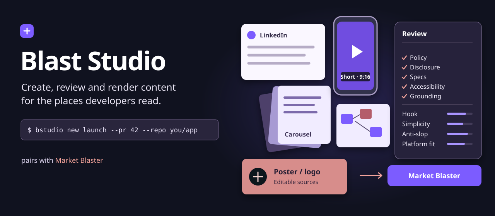
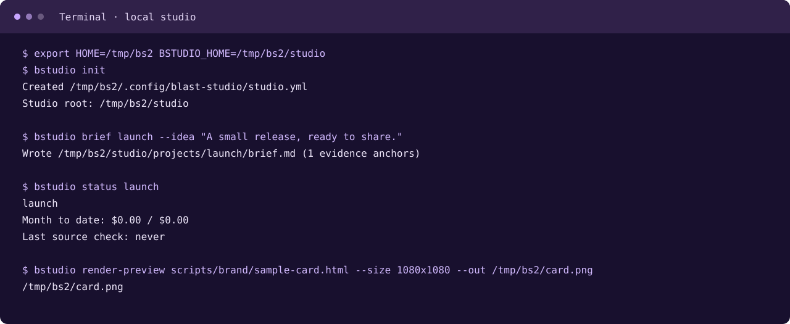

# Blast Studio { .visually-hidden }

Blast Studio creates and reviews platform-ready content from ideas, notes, links, commits, pull requests, or a Market Blaster brief. It prepares text and media for review and exports content to Market Blaster for publishing.

```bash
gh repo clone edwinjosechittilappilly/blast-studio && cd blast-studio
npm ci && npm link
bstudio init
```

Requires Node 22.18 or newer. See [getting started](getting-started.md) for setup and provider requirements.

<div class="grid cards" markdown>

- **[Getting started](getting-started.md)**

    Install the CLI and configure your studio.

- **[Workflow](workflow.md)**

    Create a brief, plan content, render assets, and review the results.

- **[Formats](formats.md)**

    Explore text, images, carousels, diagrams, and video.

- **[Review](review.md)**

    Understand platform gates, reviewer scores, and human acceptance.

</div>



See the [command reference](commands.md) for the full CLI and [platform packs](platforms.md) for platform-specific guidance.
